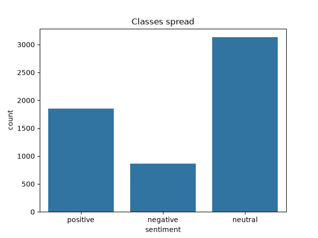
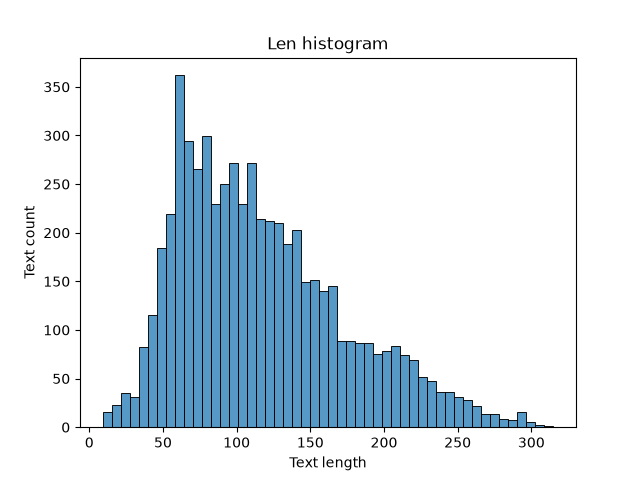

# День 1 — первые наблюдения о данных

## Задача

Классификация тональности финансовых новостей и сообщений: по тексту предсказать один из трёх классов — `negative`, `neutral`, `positive`. Мультиклассовая задача, один текст — одна метка.

## Датасет

- Файл `data.csv`, **5842 строки**, 2 колонки: `Sentence` → переименована в `text`, `Sentiment` → в `sentiment`.
- Обе колонки строковые, **пропусков нет**.

## Баланс классов

| Класс | Количество | Доля |
|---|---|---|
| neutral | 3130 | 53.6% |
| positive | 1852 | 31.7% |
| negative | 860 | 14.7% |

- Классы **несбалансированы**: negative в 3.6 раза реже, чем neutral.
- Риск: модель будет чаще предсказывать neutral и плохо находить negative. Поэтому accuracy будет обманчивой — нужна **macro F1**, где все классы весят одинаково.

## Длины текстов

- Тексты **короткие**: в среднем 117 символов / 21 слово, медиана 19 слов, максимум 315 символов / 81 слово. Это заголовки или одно предложение — у модели мало контекста.
- Есть очень короткие тексты, от 9 символов / 2 слов: `Welcome !`, `It 's not .`, `long $AAPL`. Тональность части из них трудно определить даже человеку.
- По длине классы почти не различаются (среднее 19.3 / 22.1 / 19.9 слова для negative / neutral / positive) — длина не поможет отличать классы, модель должна опираться на слова.

## Что видно по примерам

- **Два разных источника текстов**:
  - формальные финансовые новости (в основном о финских компаниях), уже токенизированные — пробелы перед знаками препинания: `19 percent , to 351 million euros .` (так выглядят ~4750 текстов);
  - сообщения с биржевых форумов/твиттера: тикеры (`$TSLA`, `$FB` — 675 текстов), ссылки (`http://...` — 251 текст), разговорный стиль.
- **Мусорные символы**: двойные обратные кавычки ` `` `, ссылки.
- **Спорная разметка**: например, «*operating result will be lower than the break-even posted a year earlier*» помечено как neutral, хотя по смыслу ближе к negative.

## Качество данных: дубликаты

- **520 текстов повторяются**, причём у **514 из них** копии размечены **разными** классами (один и тот же текст встречается, например, и как neutral, и как negative). Полностью одинаковых строк (текст + метка) всего 6.
- Это значит, что часть меток противоречит друг другу, и модель в принципе не может угадать их все — это ограничивает достижимое качество.
